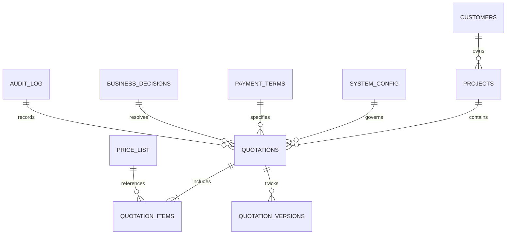

# BRIXEN Quotation Management Platform — Database Schema & Architecture

**Target Google Spreadsheet:**  
- **Name:** BRIXEN Commercial Quotation Database  
- **URL:** [https://docs.google.com/spreadsheets/d/16erzJs5DAnegKw_2_7882J3VvBugH7Lar9Rz2jeOviQ/edit?usp=sharing](https://docs.google.com/spreadsheets/d/16erzJs5DAnegKw_2_7882J3VvBugH7Lar9Rz2jeOviQ/edit?usp=sharing)  
- **Spreadsheet ID:** `16erzJs5DAnegKw_2_7882J3VvBugH7Lar9Rz2jeOviQ`  
- **Engine:** Google Apps Script / Google Sheets 3NF Normalized Relational Store  
- **Schema Version:** 1.0.0 (Production)

---

## 1. Architectural Overview

The BRIXEN database engine models the complete lifecycle of architectural aluminum, glass, doors, windows, and cladding quotations. Designed with 3NF relational normalization across 12 dedicated worksheets, it enforces:
1. **Idempotent Initialization:** Automated creation, formatting, and column definition via `initializeDatabase()` with zero data overwrites.
2. **Auditability & Traceability:** Immutable transaction logging for every quote revision, price change, and system event.
3. **Enterprise Integrity:** Unique primary keys, strict foreign key references, and standardized column naming conventions.

---

## 2. Master Worksheets Specification

### Worksheet 1: `Quotations` (Master Transaction Record)
- **Sheet Name:** `Quotations`
- **Primary Key:** `QuotationID` (e.g. `QT-20261027-001`)
- **Unique Business Key:** `ReferenceNo` (e.g. `BRX/QT/KHB/2710/2026`, `BRX-QT-KRIS-0909-2026`)
- **Tab Color:** Corporate Navy (`#1F4E79`) | Frozen Rows: 1

| Column Index | Column Header | Data Type | Constraint / Validation | Description |
|:---|:---|:---|:---|:---|
| A | `QuotationID` | String | PK, Non-null, Unique | System internal UUID/ID |
| B | `ReferenceNo` | String | Unique, Indexed | Official reference number displayed on document |
| C | `Version` | Integer | Min: 1, Default: 1 | Revision number of the quotation |
| D | `CustomerID` | String | FK -> Customers.CustomerID | Linked customer identifier |
| E | `CustomerName` | String | Non-null | Name of individual or entity |
| F | `ProjectID` | String | FK -> Projects.ProjectID | Linked project identifier |
| G | `ProjectName` | String | Non-null | Full project title (e.g. فلة الخبر) |
| H | `Language` | String | Enum: `AR`, `EN` | Quotation document language |
| I | `Date` | Date/String | YYYY-MM-DD | Issuance date |
| J | `ExpiryDate` | Date/String | YYYY-MM-DD | Calculated validity date (Date + ValidityDays) |
| K | `Status` | String | Enum: `DRAFT`, `ISSUED`, `ACCEPTED`, `REVISED`, `CANCELLED` | Lifecycle state |
| L | `Currency` | String | Default: `SAR` | Statutory billing currency |
| M | `Subtotal` | Currency (SAR) | 2 Decimals, Calculated | Sum of all line item totals before tax |
| N | `DiscountAmount` | Currency (SAR) | 2 Decimals, >= 0 | Negotiated commercial discount |
| O | `NetSubtotal` | Currency (SAR) | 2 Decimals, Calculated | Subtotal minus Discount |
| P | `VATRate` | Percentage | Default: `0.15` (15%) | Statutory VAT rate |
| Q | `VATAmount` | Currency (SAR) | 2 Decimals, Calculated | NetSubtotal * VATRate |
| R | `GrandTotal` | Currency (SAR) | 2 Decimals, Calculated | NetSubtotal + VATAmount |
| S | `MinChargeItemsCount` | Integer | >= 0 | Count of openings where Rule (*) was triggered |
| T | `PaymentTermsID` | String | FK -> Payment_Terms.TermID | Active commercial payment milestone profile |
| U | `PdfDriveFileId` | String | Drive ID | Google Drive file ID of the generated PDF |
| V | `PdfDriveUrl` | URL | Drive Link | Direct link to view/download PDF |
| W | `CreatedBy` | String | Email / User ID | Platform user who drafted the quote |
| X | `CreatedAt` | Timestamp | ISO 8601 | Record creation timestamp |
| Y | `UpdatedAt` | Timestamp | ISO 8601 | Last modification timestamp |

---

### Worksheet 2: `Quotation_Items` (BOQ Schedule Breakdown)
- **Sheet Name:** `Quotation_Items`
- **Primary Key:** `ItemID`
- **Foreign Key:** `QuotationID` -> `Quotations.QuotationID`
- **Tab Color:** Corporate Navy (`#1F4E79`) | Frozen Rows: 1

| Column Index | Column Header | Data Type | Formula / Logic | Description |
|:---|:---|:---|:---|:---|
| A | `ItemID` | String | PK, Unique | Internal line item identifier |
| B | `QuotationID` | String | FK | Parent quotation link |
| C | `ItemNumber` | Integer | 1, 2, 3... | Position sequence in table |
| D | `ItemCode` | String | e.g. D1, W4, CL | Architectural opening reference tag |
| E | `Category` | String | Enum: `Doors`, `Windows`, `Cladding`, `Elevator`, `CurtainWall` | Structural group |
| F | `DescriptionAr` | String (RTL) | Text | Full technical specifications in Arabic |
| G | `DescriptionEn` | String (LTR) | Text | Full technical specifications in English |
| H | `Width` | Number | User input (m or mm) | Opening horizontal dimension |
| I | `Height` | Number | User input (m or mm) | Opening vertical dimension |
| J | `Unit` | String | `m` or `mm` | Unit of measure for W and H |
| K | `Count` | Integer | >= 1 | Number of identical units |
| L | `UnitAreaM2` | Decimal (6 dec) | `(Width * Height) / (Unit=='mm'?1e6:1)` | Physical surface area per unit |
| M | `TotalAreaM2` | Decimal (6 dec) | `UnitAreaM2 * Count` | Total physical surface area |
| N | `BilledAreaM2` | Decimal (6 dec) | Billed override if specified, else `TotalAreaM2` | Commercial billable area (e.g. 15.00 m² override) |
| O | `UnitRate` | Currency (SAR) | Price List / Input | Price per square meter or unit |
| P | `IsMinimumApplied`| Boolean | `UnitAreaM2 < 1.0 && Category in (Windows, Doors)` | Rule (*) flag (True if SAR 650 flat rate triggered) |
| Q | `LineTotal` | Currency (SAR) | `IsMin ? (Count * 650.00) : (BilledArea * UnitRate)` | Final line price before VAT |
| R | `AluminumProfile`| String | Text | Profile specification (e.g. Saraya 105mm, 45mm) |
| S | `GlassSpec` | String | Text | Glass specification (e.g. 24mm Double Glazed, 10mm Frameless) |
| T | `HardwareSpec` | String | Text | Accessories (e.g. Italian Hardware, EPDM, German GP Silicon) |
| U | `Notes` | String | Text | Fabrication remarks or opening location |

---

### Worksheet 3: `Customers` (Client Directory)
- **Sheet Name:** `Customers`
- **Primary Key:** `CustomerID` (e.g. `CUST-001`)
- **Tab Color:** Muted Slate (`#4A6572`) | Frozen Rows: 1

| Column | Header | Type | Description |
|:---|:---|:---|:---|
| A | `CustomerID` | String | PK (CUST-001, CUST-002) |
| B | `CustomerNameAr` | String | Arabic Name (الأستاذ/ عبد الخالق المري) |
| C | `CustomerNameEn` | String | English Name (Mr. Abdulkhaliq Al-Marri, Eng. Kris) |
| D | `CustomerType` | String | Individual, Contractor, Architect, Corporate |
| E | `ContactPerson` | String | Representative name |
| F | `Phone` | String | Primary mobile (+966 50 123 4567) |
| G | `Email` | String | Email address |
| H | `TaxNumber` | String | Customer VAT number (if applicable) |
| I | `Address` | String | Street address / District |
| J | `City` | String | Khobar, Riyadh, Dammam, Jeddah |
| K | `TotalQuotations` | Integer | Aggregated quote counter |
| L | `TotalSpentSAR` | Currency | Aggregated accepted revenue |
| M | `CreatedAt` | Timestamp | Registration timestamp |

---

### Worksheet 4: `Projects` (Project Directory)
- **Sheet Name:** `Projects`
- **Primary Key:** `ProjectID` (e.g. `PROJ-001`)
- **Foreign Key:** `CustomerID` -> `Customers.CustomerID`
- **Tab Color:** Muted Slate (`#4A6572`) | Frozen Rows: 1

| Column | Header | Type | Description |
|:---|:---|:---|:---|
| A | `ProjectID` | String | PK (PROJ-001, PROJ-002) |
| B | `CustomerID` | String | Linked customer |
| C | `ProjectNameAr` | String | فلة الخبر - أعمال النوافذ والأبواب والكلادينج |
| D | `ProjectNameEn` | String | Khobar Villa Project / Kris Glazing Project |
| E | `Location` | String | City or district (الخبر, الرياض) |
| F | `ScopeOfWork` | String | Windows, Doors, Cladding, Elevator Facade |
| G | `ProjectStatus` | String | Tendering, Under Construction, Completed |
| H | `EstimatedValueSAR`| Currency | Estimated contract budget |
| I | `CreatedAt` | Timestamp | Registration timestamp |

---

### Worksheet 5: `Price_List` (Approved Rate Card)
- **Sheet Name:** `Price_List`
- **Primary Key:** `ItemCode`
- **Tab Color:** Dark Olive / Green (`#2E7D32`) | Frozen Rows: 1

| Column | Header | Type | Verified Baseline Value | Description |
|:---|:---|:---|:---|:---|
| A | `ItemCode` | String | `WIN-SARAYA-105` | System item code |
| B | `Category` | String | `Windows` | Product category |
| C | `ItemNameAr` | String | نوافذ ألمنيوم قطاع سرايا 105 مم دبل جلاس | Arabic display name |
| D | `ItemNameEn` | String | Aluminum Windows Saraya 105mm D/G | English display name |
| E | `UnitOfMeasure` | String | `m²` | Unit of measure |
| F | `StandardRateSAR` | Currency | `650.00` | Baseline unit rate |
| G | `MinRateSAR` | Currency | `600.00` | Minimum allowable discount floor |
| H | `MaxRateSAR` | Currency | `750.00` | Maximum premium ceiling |
| I | `ProfileDepthMm` | Number | `105` | Aluminum frame depth |
| J | `ProfileThicknessMm`| Number| `1.5` | Extrusion wall thickness |
| K | `GlassComposition` | String | `6mm Clear + 12mm Air + 6mm Clear` | Glass makeup |
| L | `HardwareOrigin` | String | `Italian (Savio/Giesse)` | Accessory origin |
| M | `IsActive` | Boolean | `TRUE` | Active in quoting catalog |

---

### Worksheet 6: `Price_History` (Audit Trail of Price Changes)
- **Sheet Name:** `Price_History`
- **Primary Key:** `ChangeID` | **Tab Color:** Slate | Frozen Rows: 1

| Column | Header | Type | Description |
|:---|:---|:---|:---|
| A | `ChangeID` | String | PK (CHG-0001) |
| B | `ItemCode` | String | Target item code |
| C | `OldRate` | Currency | Previous rate |
| D | `NewRate` | Currency | Updated rate |
| E | `ChangedBy` | String | User email / Authorizer |
| F | `Reason` | String | Market fluctuation / Raw aluminum index |
| G | `Timestamp` | Timestamp | ISO 8601 change timestamp |

---

### Worksheet 7: `Payment_Terms` (Commercial Payment Profiles)
- **Sheet Name:** `Payment_Terms`
- **Primary Key:** `TermID` | **Tab Color:** Purple | Frozen Rows: 1

| TermID | Profile Name | Advance (MS1) | Factory Ready (MS2) | Milestone 3 (MS3) | Operational Conflict Flag |
|:---|:---|:---|:---|:---|:---|
| `TERM-AR-KHOBAR` | Arabic Standard (Strict 100% Upfront) | 50% on Contract | 45% Ready at Factory | 5% On Start of Installation | High Vendor Protection (Zero site retention) |
| `TERM-EN-KRIS` | English Standard (Retention Model) | 50% on Advance | 45% Ready for Dispatch | 5% After Handover (HO) | Standard Industry Construction Retention |

---

### Worksheet 8: `System_Config` (Global Parameters & Governance)
- **Sheet Name:** `System_Config`
- **Primary Key:** `ConfigKey` | **Tab Color:** Charcoal | Frozen Rows: 1

| ConfigKey | ConfigValue | Data Type | Category | Description |
|:---|:---|:---|:---|:---|
| `COMPANY_NAME_AR` | شركة بريكسن ذات مسؤولية محدودة | String | Identity | Official Arabic commercial name |
| `COMPANY_NAME_EN` | BRIXEN LLC | String | Identity | Official English commercial name |
| `CR_NUMBER` | `7054850701` | String | Statutory | Ministry of Commerce C.R. |
| `VAT_NUMBER` | `300000000000003` | String | Statutory | ZATCA Tax Registration |
| `BANK_NAME` | مصرف الراجحي (Al-Rajhi Bank) | String | Banking | Sole authorized depository bank |
| `BANK_IBAN` | `SA4080000510608010602103` | String | Banking | Official operational IBAN |
| `DEFAULT_VAT_RATE` | `0.15` | Decimal | Tax | Statutory 15% VAT rate |
| `RULE_STAR_THRESHOLD_M2` | `1.000` | Decimal | Pricing | Rule (*) minimum opening area |
| `RULE_STAR_SURCHARGE_SAR` | `650.00` | Decimal | Pricing | Rule (*) flat charge for < 1.0 m² |
| `QUOTE_VALIDITY_DAYS_AR` | `3` | Integer | Terms | Strict validity in Arabic contracts |
| `QUOTE_VALIDITY_DAYS_EN` | `30` | Integer | Terms | Validity in English contracts |
| `LEAD_TIME_SUPPLY_DAYS` | `30` | Integer | Operations | Calendar days for factory supply |
| `LEAD_TIME_INSTALL_DAYS` | `10` | Integer | Operations | Calendar days for on-site installation |

---

### Worksheet 9: `Business_Decisions` (Governance & Status Register)
- **Sheet Name:** `Business_Decisions`
- **Primary Key:** `DecisionID` | **Tab Color:** Amber | Frozen Rows: 1

| DecisionID | Title | Selected Option | Status | Impact Area |
|:---|:---|:---|:---|:---|
| `DEC-001` | Milestone 3 Payment Timing | `DYNAMIC_BY_CLIENT` | `PENDING_REVIEW` | Contractual cash flow & retention |
| `DEC-002` | Offer Validity Period | `DYNAMIC_BY_DOC` | `PENDING_REVIEW` | Price volatility risk protection |
| `DEC-003` | Rule (*) Minimum Surcharge Scope | `AUTOMATIC_ALL_OPENINGS` | `CONFIRMED` | Revenue protection on small windows |
| `DEC-004` | Standard Commercial Rate Card | `STANDARD_TIERED` | `PENDING_REVIEW` | Margins & back-calculation control |

---

### Worksheet 10: `Audit_Log` (Transaction & User Activity Trail)
- **Sheet Name:** `Audit_Log`
- **Primary Key:** `LogID` | **Tab Color:** Slate Gray | Frozen Rows: 1

| Column | Header | Type | Description |
|:---|:---|:---|:---|
| A | `LogID` | String | Unique log identifier (LOG-...) |
| B | `Timestamp` | Timestamp | ISO 8601 execution time |
| C | `Action` | String | `INITIALIZE_DB`, `ISSUE_QUOTE`, `UPDATE_PRICE`, `REVISE_QUOTE` |
| D | `Entity` | String | `QUOTATION`, `PRICE_LIST`, `DECISION` |
| E | `EntityID` | String | Impacted entity ID |
| F | `UserEmail` | String | Active session user email |
| G | `Details` | JSON / Text | Serialized payload diff or transaction summary |

---

### Worksheet 11: `Quotation_Versions` (Revision History)
- **Sheet Name:** `Quotation_Versions`
- **Primary Key:** `VersionID` | **Tab Color:** Blue | Frozen Rows: 1
- Tracks complete snapshot of every quotation revision before updates occur, preserving historical BOQ items, sums, and status changes.

---

### Worksheet 12: `Schema_Version` (Migration & Meta Tracking)
- **Sheet Name:** `Schema_Version`
- **Primary Key:** `Version` | **Tab Color:** Dark Green | Frozen Rows: 1
- Records database schema releases, migration scripts executed, date applied, and database verification status.
