# BRIXEN LLC — Executive Memorandum: Resolution of Four Outstanding Business Decisions

**Prepared For:** Board of Directors & Commercial Executive Committee, BRIXEN LLC  
**Date:** 28 October 2026  
**Document ID:** MEMO-BRIXEN-DEC-2026-01  
**Subject:** Resolution of Critical Commercial Discrepancies and Operating Rules for the Automated Quotation Engine

---

## 1. Executive Summary

During the reverse-engineering and forensic audit of BRIXEN’s operational quotation archives, four significant commercial discrepancies were identified between existing Arabic contracts (`BRIXEN_Quotation_Khobar_Villa_27Oct2026`) and English contracts (`BRIXEN_Quotation_Eng_Kris_09Sep2026_Final_Rates`).

To ensure that the automated quotation engine operates with statutory compliance, predictable cash flows, and zero ambiguity, the Executive Committee must review and confirm the recommended resolutions detailed below during tomorrow's executive session.

In the automated platform, these four parameters are managed through dedicated administrative controls and the `Business_Decisions` worksheet, allowing instantaneous configuration updates.

---

## 2. Detailed Decision Matrix

```mermaid
flowchart TD
    subgraph Decisions["Executive Commercial Decisions"]
        D1["Decision 1: Milestone 3 (5%) Timing"]
        D2["Decision 2: Quotation Validity"]
        D3["Decision 3: Rule (*) Minimum Surcharge"]
        D4["Decision 4: Standard Rate Card Architecture"]
    end

    D1 --> O1["Arabic: 100% Upfront (Install Start)"]
    D1 --> O2["English: Retention (After Handover)"]
    D1 --> R1["RECOMMENDED: Segment by Client Type"]

    D2 --> V1["Arabic: 3 Calendar Days (Strict)"]
    D2 --> V2["English: 30 Days (Standard)"]
    D2 --> R2["RECOMMENDED: 3 Days for Retail / 14 Days for Commercial"]

    D3 --> S1["Enforce SAR 650 on all < 1.0 m²"]
    D3 --> R3["RECOMMENDED: Enforce Automaticaly (Revenue Protected)"]

    D4 --> P1["Floating Back-Calculation"]
    D4 --> P2["Strict Fixed Rate Card"]
    D4 --> R4["RECOMMENDED: Standard Baseline + Commercial Margin Floor"]
```

---

### Decision 1: Milestone 3 Payment Timing (Contractual Cash Flow & Risk)

#### Context & Evidence
- **Arabic Quote (Khobar Villa - Section 3, Bullet 3):**
  > `شروط الدفع: 50% عند توقيع العقد، و45% عند جاهزية المواد بالمصنع وقبل التوريد، و5% عند البدء بالتركيب.`  
  > *Analysis:* **100% of the contract value is collected before or at the moment of site arrival.** The client has zero retention holdback on BRIXEN during the physical installation phase. This offers maximum credit risk protection for the fabricator.
- **English Quote (Eng. Kris - Section 3, Bullet 3):**
  > `Payment Terms: 50% Advance with Purchase Order, 45% Ready for Dispatch, 5% After HO (Handover).`  
  > *Analysis:* Standard FIDIC/contractor retention. The final 5% is withheld until final inspection, snag list clearance, and handover.

#### Financial & Operational Impact
If a residential client signs an English template with "5% After HO", collection can be delayed by 30 to 90 days pending civil contractor works on site, creating uncollected working capital deficits. Conversely, major corporate contractors or tier-1 consultants frequently refuse 100% pre-installation payment terms.

#### Available Options
- **Option A (Strict Upfront):** Enforce 5% upon start of installation for all clients across all languages.
- **Option B (Retention Standard):** Standardize 5% after Handover across all quotations.
- **Option C (Client-Segmented Dynamic Rule — RECOMMENDED):**
  - **Private / Residential / Individual Clients:** Strictly 5% upon start of installation (100% pre-completion).
  - **Corporate / Main Contractors / Commercial Projects:** 5% upon Handover or 30 days post-completion, subject to credit approval.

---

### Decision 2: Quotation Validity Period (Raw Aluminum Price Volatility)

#### Context & Evidence
- **Arabic Quote (Khobar Villa):**
  > `مدة صلاحية عرض السعر: ثلاثة (3) أيام من تاريخ العرض`  
  > *Analysis:* A hyper-strict 3-day validity window. Designed to shield BRIXEN from sudden global London Metal Exchange (LME) aluminum ingot price surges and glass supplier surcharge fluctuations.
- **English Quote (Eng. Kris):**
  > Offers no explicit expiry restriction or defaults to the industry-standard 30 calendar days.

#### Risk Analysis
Aluminum billets and glass constitute over 65% of direct bill of materials (BOM) cost. A quote left open for 30 days during an inflationary cycle can erode gross margins by 8% to 15%. However, a 3-day window is impractical for institutional clients whose procurement evaluation cycles typically take 10 to 14 days.

#### Available Options
- **Option A:** Universal 3-day validity (Extremely protective, may discourage corporate bidding).
- **Option B:** Universal 30-day validity (High margin risk in volatile commodities market).
- **Option C (Dual-Tier Policy — RECOMMENDED):**
  - **Standard Residential & Retail (Private Villas):** **7 Calendar Days** (expanded from 3 days to provide realistic signing time while limiting exposure).
  - **Commercial & Tenders:** **14 Calendar Days** with a mandatory LME raw materials escalation clause.

---

### Decision 3: Rule (*) Minimum Surcharge Scope & Governance

#### Context & Evidence
- **Arabic Quote (Khobar Villa - Section 2 & 3):**
  > `علامة (*) تعني تطبيق الحد الأدنى بقيمة 650 ريال للوحدة التي تقل مساحتها عن 1 م².`  
  > In the Khobar Villa project, Rule (*) was automatically applied to 4 distinct openings:
  > - W4 Maid Room ($0.40 \times 0.60\text{ m} = 0.24\text{ m}^2$): Area value = SAR 156.00 $\rightarrow$ **Billed at SAR 650.00** ($+\text{SAR } 494.00$)
  > - W5 Store ($0.60 \times 0.80\text{ m} = 0.48\text{ m}^2$): Area value = SAR 312.00 $\rightarrow$ **Billed at SAR 650.00** ($+\text{SAR } 338.00$)
  > - W9 Master Bath ($0.67 \times 1.24\text{ m} = 0.83\text{ m}^2$): Area value = SAR 540.02 $\rightarrow$ **Billed at SAR 650.00** ($+\text{SAR } 109.98$)
  > - W14 Annex Bath ($0.66 \times 0.76\text{ m} = 0.50\text{ m}^2$): Area value = SAR 326.04 $\rightarrow$ **Billed at SAR 650.00** ($+\text{SAR } 323.96$)
  > **Total Pure Profit Protection:** **SAR 1,265.94** (+2.4% uplift on total quote value).

#### Engineering Rationale
Fabricating a small bathroom tilt window ($0.24\text{ m}^2$) consumes identical corner cleats, gaskets, locking gear, and extrusion cutting labor as a standard $1.5\text{ m}^2$ window. Billing strictly by square meter results in an operational loss on the opening.

#### Recommendation
- **CONFIRMED & LOCKED:** Rule (*) must remain **mandatory and automatically calculated** by the platform for all aluminum windows and doors with $\text{Unit Area} < 1.000\text{ m}^2$.
- The platform UI explicitly flags these items with `*` and displays an informative notification so the sales team can defend the surcharge transparently.

---

### Decision 4: Standard Commercial Rate Card Architecture

#### Context & Evidence
- **Khobar Villa Quote:**
  - Saraya Windows & Doors: Standard baseline **SAR 650.00 / m²**.
  - Cladding: **SAR 350.00 / m²**.
  - Frameless Elevator Glass: **SAR 350.00 / m²**.
- **Eng. Kris Quote:**
  - Back-calculated fractional rates to achieve a target lump sum of SAR 40,000.00 Net (SAR 46,000.00 Gross):
  - Fixed Windows: SAR 1,018.07 / m²
  - Sliding Windows: SAR 1,018.07 / m²
  - Cladding: SAR 407.23 / m²

#### Problem Statement
Ad-hoc pricing creates margin inconsistency and customer disputes when clients compare unit rates across different projects.

#### Recommendation (Tiered Baseline Catalog)
Adopt a standardized corporate rate card in the `Price_List` worksheet:
1. **Tier 1 (Residential Private Villas - Standard Saraya 105mm D/G):** SAR 650.00 / m²
2. **Tier 2 (Commercial / Heavy-Duty Thermal Break Systems):** SAR 850.00 – 1,100.00 / m²
3. **Cladding Local Fire-Rated (4mm PVDF):** SAR 350.00 / m² baseline
4. **Frameless Tempered Glass (10mm Clear):** SAR 350.00 / m² baseline
5. **Discount Floor Control:** Platform enforces a minimum rate floor (e.g. SAR 600.00 for Saraya) preventing sales representatives from discounting below cost without managerial approval.

---

## 3. Executive Action Required

During tomorrow's meeting, the committee should formally vote to ratify:
1. [ ] Adoption of **Client-Segmented Payment Terms** (Option C).
2. [ ] Standardization of **7-Day Validity for Residential** and **14-Day for Commercial**.
3. [ ] Re-affirmation of **Rule (*) Automated Minimum Charge (SAR 650.00)**.
4. [ ] Approval of the **Standard Rate Card with 5% Discretionary Sales Threshold**.
